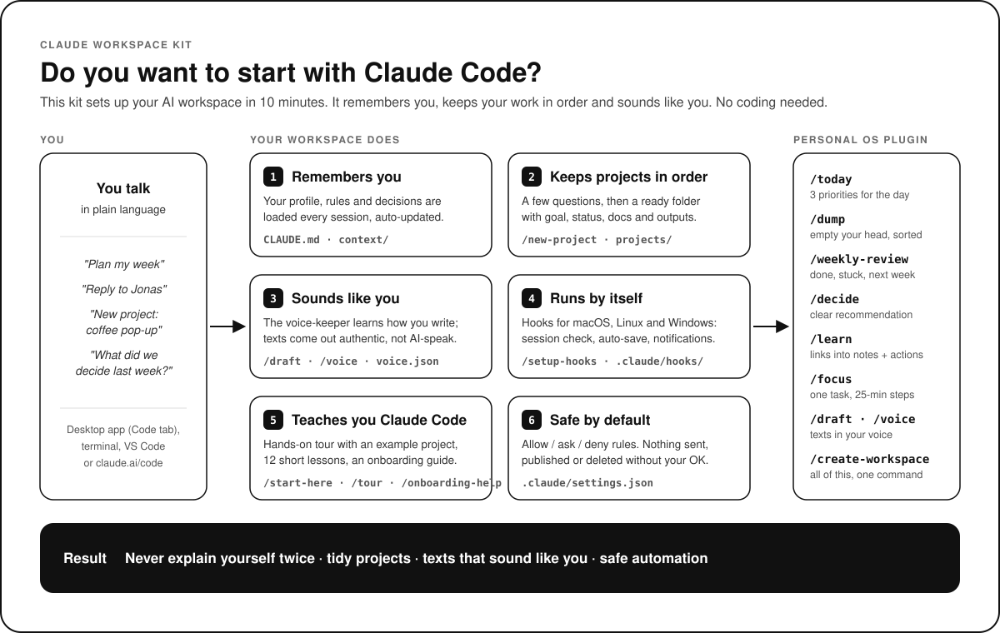

<p align="center">
  <a href="https://claude.com/claude-code"></a>
  
  
  <a href="LICENSE"></a>
</p>

# Claude Workspace Kit

**Your personal AI workspace for Claude Code. Built for people who don't code.**

<p align="center">
  
</p>

You talk, Claude works. This kit gives Claude a clean home on your computer: one place where it remembers who you are, how you like to work, and what every project is about. You never have to explain yourself twice.

---

## What you get

```
claude-workspace-kit/
├── CLAUDE.md            ← Claude's master instructions (read at the start of every session)
├── AGENTS.md            ← the same rules for other AI tools (Codex, Cursor, …)
├── context/             ← who you are, how you work, what you decided (Claude keeps this up to date)
├── projects/            ← one folder per project, each with its own CLAUDE.md and docs/
│   └── _template/       ← the blueprint /new-project copies
├── examples/            ← a fictional example project for the guided tour
├── guide/               ← 12 short lessons: how Claude Code works
└── .claude/
    ├── settings.json    ← safety rules (what Claude may and may not do)
    ├── skills/          ← your slash commands
    ├── agents/          ← helpers: the onboarding guide and the voice-keeper
    └── hooks/           ← automations for macOS, Linux and Windows
```

| Command | What it does |
|---|---|
| `/start-here` | First run. Claude interviews you (5 minutes), fills `context/` and switches on the automations. |
| `/tour` | Guided hands-on tour (15–20 minutes) with an example project. Learn by doing. |
| `/new-project` | Asks a few questions, then builds a ready-to-use project folder. |
| `/draft` | Emails, messages and posts that sound like **you**, two versions, learns from your edits. |
| `/voice` | Train, show or test your writing voice (`context/voice.json`). |
| `/onboarding-help` | Your personal teacher: skills, commands, memory, rules, permissions, and more. |
| `/update-context` | Saves what Claude learned into your workspace. Runs **automatically** (hook) every few answers and whenever you say things like "remember" or "from now on". |
| `/setup-hooks` | Detects your system (macOS, Linux, Windows) and installs the matching automations. |
| `/wrap-up` | End of session: summary, open to-dos, context updated. |

---

## What is Claude Code?

Claude Code is Anthropic's AI agent that works **directly in a folder on your computer**. Normal Claude chat answers questions; Claude Code *does the work*: it reads your files, writes new ones, organises folders, researches, runs small tools and remembers your rules, all inside the folder you open. It started as a tool for programmers, but everything that is "files and words" works just as well for non-coders: plans, emails, research, notes, content, client projects.

You can use it in the **Claude Desktop app (Code tab)**, in a **terminal**, in **VS Code / Cursor**, or in the browser at **claude.ai/code**. All of them read the same workspace files.

## Claude Code vs. Cowork: which one, and why this kit uses Claude Code

Cowork is the agent mode in the Claude Desktop app for everyday knowledge work. It's great for quick tasks on your files and apps. Claude Code is the more powerful, more controllable sibling. This kit is built for Claude Code, because a *workspace* needs exactly what Claude Code adds:

| | Cowork | Claude Code |
|---|---|---|
| Works on files in a folder | Yes | Yes |
| Reads the workspace rulebook (`CLAUDE.md`) automatically, including project rulebooks | Not documented; set instructions per Cowork project | **Yes**, every session, for every folder level |
| Your own slash commands from the folder (`.claude/skills/`) | Only via installed plugins | **Yes**, straight from the folder; plugins too |
| Safety rules you control (allow / ask / deny lists) | Basic | **Yes**, per workspace, readable and shareable (`.claude/settings.json`) |
| Automations (hooks): auto-save context, session start check, notifications | Via plugins only | **Yes**, per workspace and per computer |
| Plan mode (think first, change nothing until you approve) | No equivalent | **Yes** (Shift+Tab) |
| Undo Claude's edits (`/rewind`) | No | **Yes** |
| Helpers working in parallel (subagents) | Limited | **Yes**, including your own specialists (`.claude/agents/`) |
| Versions, backups and teamwork with Git / GitHub, pull requests | No | **Yes** |
| Works on the phone / in the browser on the same project | Dispatch (sends tasks to your desktop) | claude.ai/code, Remote Control |
| Same setup for colleagues | Share plugins | **Share the folder** (or a GitHub repo): same rules, commands and safety for everyone |

**In one sentence:** Cowork is a smart assistant you hand tasks to; Claude Code with this kit is a whole office that remembers you, follows your rules, automates the boring parts and grows with every project.

You don't have to choose forever: the **Personal OS** plugin (below) also works in Cowork and chat. Feature details change quickly; check claude.com/docs for the latest.

---

## Setup (10 minutes)

### 1. Get Claude Code
You need a paid Claude plan (Pro, Max, Team or Enterprise). Then pick **one** way to use Claude Code:

- **Easiest: Claude Desktop app.** Download from claude.ai/download, sign in, open the **Code** tab. No terminal needed.
- **Terminal:** install Claude Code (see claude.com/claude-code for the one-line installer), then type `claude` in a terminal.
- **VS Code / Cursor:** install the "Claude Code" extension.

### 2. Put this folder somewhere permanent
For example `Documents/Claude-Workspace`. Rename it if you like. This folder *is* your workspace. Don't put it inside a cloud-sync folder that might rename files while Claude works (iCloud/OneDrive "optimize storage" can cause trouble).

### 3. Open the folder in Claude Code
- Desktop app: Code tab → choose folder → select your workspace folder.
- Terminal: `cd` into the folder, then run `claude`.

When Claude asks whether you trust this folder, say **yes**. Only then do the safety rules and slash commands in `.claude/` switch on.

### 4. Type `/start-here`, then `/tour`
Answer Claude's questions, say yes to the automations, then take the guided tour. That's it.

**Prefer a dedicated guide?** In the terminal, `claude --agent onboarding-guide` starts a whole session as the onboarding guide.

---

## How to work day to day

1. Open your workspace folder in Claude Code.
2. Say what you want in plain language. "Write a cold email for the Vienna gym project." Claude knows which project you mean and what you already decided.
3. When you're done: `/wrap-up`.

**Tip:** Always open the **workspace folder** itself, not a project sub-folder. Your commands, safety rules and automations live in the workspace's `.claude/` folder and only load from there. To focus on one project, just say its name.

---

## The three rules this kit follows

1. **Context lives in files, not in chat.** Chats get forgotten. Files don't. Everything important ends up in `context/` or in a project's `docs/`.
2. **One project, one folder.** Nothing floats around loose.
3. **Claude asks before anything risky.** Deleting, sending, publishing, spending money: always with your OK. Some things are blocked completely (see `.claude/settings.json` and `guide/07-permissions-and-safety.md`).

---

## Your voice: authentic texts, not AI-speak
The **voice-keeper** agent builds a profile of how you write in `context/voice.json`: tone, sentence length, favourite words and phrases, how you open and close emails or messages, emojis, how you sound to clients vs. friends, plus a few real examples (names of others removed). `/draft` writes with it, and every time you correct a draft, the voice-keeper learns from the difference. The automatic context hook passes your own texts to it, too.

Start with `/voice train` and 3–5 texts you wrote yourself. Check what it learned with `/voice show`.

## Automations (hooks)
After `/start-here` (or `/setup-hooks`) four small automations run by themselves:
- **Session start:** Claude checks your active projects and, on the very first run, offers the setup and the tour.
- **Auto-context:** every few answers, and right after you say something worth remembering, Claude saves it to your files and tells you in one line.
- **Notification:** you get a notice (or a beep on Windows) when Claude is waiting for you.
Details and how to switch them off: `.claude/hooks/README.md`.

## Plugin: Personal OS

Planning, thinking, writing and learning commands for daily life. Works inside this workspace (it reads `context/` and `projects/`) and on its own, in Claude Code, Cowork and chat.

| Command | What it does |
|---|---|
| `/today` | Morning plan: 3 priorities with time estimates, saved to `journal/` |
| `/dump` | Brain dump: everything out of your head, sorted into projects, to-dos, dates, ideas |
| `/weekly-review` | Done, stuck, quiet projects, inbox, top 3 for next week |
| `/draft` | Emails, messages and posts in your voice, two versions, learns your style (voice-keeper agent) |
| `/voice` | Train, show or test your writing voice |
| `/decide` | Options, criteria, devil's advocate, a clear recommendation, logged with reasons |
| `/learn` | Link, PDF or transcript → short note with actions, filed in the right place |
| `/focus` | One task, cut into 25-minute steps, done together |
| `/create-workspace` | Builds this whole workspace in any empty folder |

**Install in the Claude apps:** Customize → Plugins → Add marketplace → `fuchs-harry/claude-workspace-kit` → install **personal-os**.
**Install in Claude Code:** `/plugin marketplace add fuchs-harry/claude-workspace-kit`, then `/plugin install personal-os@claude-workspace-kit`.

Two ways to start: download this repo (Code → Download ZIP) and open the folder, **or** install the plugin and type `/create-workspace` in an empty folder.

## Need help?
Type `/onboarding-help`. Or just ask Claude: "How does X work in Claude Code?"
